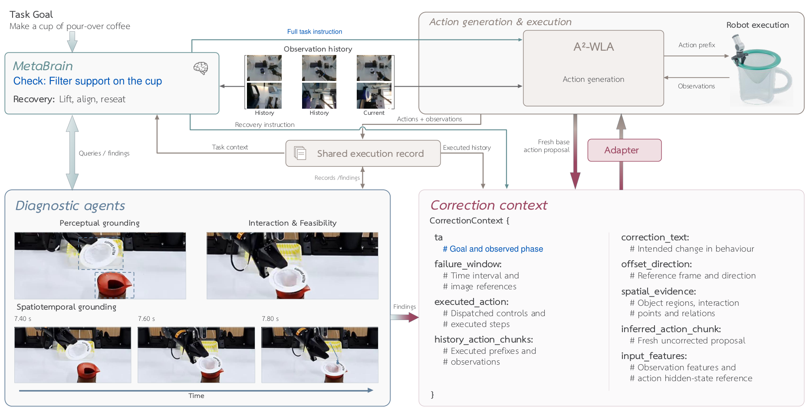
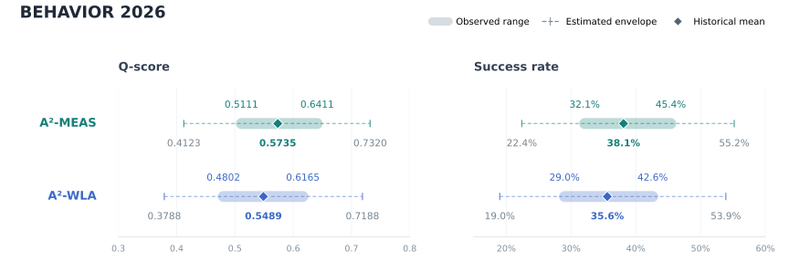

<div align="center">

<h1>Toward the Era of<br>Agentic Embodied Intelligence</h1>

<p>
  <strong>A²-MEAS</strong> — An Embodied Multi-Agent Framework
</p>

<p>
  <strong><a href="https://zhipengzhang.cn/">AutoLab</a></strong>, School of Artificial Intelligence, Shanghai Jiao Tong University<br>
  Research Lab, Anyverse Dynamics
</p>

<p>
  <a href="https://arxiv.org/abs/2611.09124"></a>
  <a href="https://a2-meas.github.io/"></a>
  <a href="https://huggingface.co/shibohuang/policy-weights/tree/9d27ec2109a05aa3fe15c5678069ea3483be1a80"></a>
  <a href="https://hub.docker.com/r/shibohuang/a2meas"></a>
  <a href="LICENSE"></a>
</p>

<p>
  <a href="#overview">Overview</a> ·
  <a href="#setup">Setup</a> ·
  <a href="#evaluation">Evaluation</a> ·
  <a href="#results">Results</a> ·
  <a href="#citation">Citation</a>
</p>

</div>

## Overview

**A²-MEAS** is an embodied multi-agent framework for long-horizon robot tasks. It connects **A²-WLA** action generation, **MetaBrain** task reasoning, and diagnostic agents through a shared execution record and a learned correction interface.

A²-WLA combines motion-aware observation history with a latent world model. Grounded correction codes guide recovery while model weights remain fixed at deployment.

This release provides inference and benchmark evaluation on **RoboTwin 2.0** and **BEHAVIOR 2026**.

<p align="center">
  
</p>

## Setup

Choose either [native installation](#native-installation) or [Docker installation](#docker-installation). Both use the same [evaluation commands](#evaluation).

### Requirements

- **Hardware:** Linux x86-64 and an NVIDIA GPU with native BF16 and Vulkan/EGL support.
- **GPU driver:** CUDA 12.8-compatible driver.
- **Adapter judge:** CUDA 13-compatible driver and 96 GiB GPU memory with the default configuration; required when using `--adapter`.
- **Storage:** 250 GiB for BEHAVIOR weights and preparation files, plus simulator assets.

Request access to the [SAM checkpoint](https://huggingface.co/facebook/sam3.1) on Hugging Face. For BEHAVIOR, also accept the [asset terms](https://behavior.stanford.edu/getting_started/installation.html). The installer prompts for Hugging Face login when needed.

### Native installation

Requires Conda and glibc ≥ 2.28 for RoboTwin or ≥ 2.35 for BEHAVIOR.

Run from the repository root. On Ubuntu:

```bash
sudo apt-get update
sudo apt-get install -y build-essential git curl ca-certificates \
  libegl1 libgl1 libglu1-mesa libxt6 libglib2.0-0 libvulkan1 libxext6 libzstd1
bash setup.sh --benchmark all --adapter
```

Environments are stored in `../a2meas-runtime` and linked as `runtime/`. Weights and assets are stored in `resources/`.

### Docker installation

Requires Docker Engine, NVIDIA Container Toolkit, and acceptance of the NVIDIA terms. The image includes the runtime environments and source code; download weights and simulator assets using the setup command below.

On the host, choose a directory for resources and results:

```bash
docker pull shibohuang/a2meas:full
mkdir -p resources results
docker run --rm -it --gpus all \
  -v "$PWD/resources:/opt/a2meas/resources" \
  -v "$PWD/results:/opt/a2meas/results" \
  -v a2meas-cache:/opt/a2meas-runtime/cache \
  shibohuang/a2meas:full bash
```

Inside the container, download resources:

```bash
cd /opt/a2meas
bash setup.sh --benchmark all --adapter --download-only
```

Host directories retain resources and results; `a2meas-cache` retains download and runtime caches.

## Evaluation

Run from the repository root, or from `/opt/a2meas` inside Docker. The examples below use eight GPUs. Use a new output directory each time; run jobs sequentially on shared GPUs.

| Benchmark | Evaluation protocol |
| --- | --- |
| RoboTwin 2.0 | 50 tasks × 2 settings × 100 episodes |
| BEHAVIOR 2026 | 100 tasks × 10 public-test instances |

### RoboTwin 2.0

```bash
unset LD_PRELOAD
runtime/model/bin/python evaluate.py robotwin \
  --gpus 0 1 2 3 4 5 6 7 --workers-per-gpu 8 \
  --episodes 100 --output-dir results/robotwin-run
```

The command evaluates both `demo_clean` and `demo_randomized`, with [RSI](configs/robotwin/rsi.json) enabled. Set `ROBOTWIN_RSI=false` for policy-only evaluation or `EVAL_VIDEO_LOG=true` to record videos.

### BEHAVIOR 2026

```bash
unset LD_PRELOAD
runtime/model/bin/python -m benchmarks.behavior.run \
  --gpus 0 1 2 3 4 5 6 7 --workers-per-gpu 4 \
  --num-inference-steps 2 --instance $(seq 0 9) --adapter \
  --output-dir results/behavior-run
```

The command evaluates public-test indices 0–9 (IDs 301–310). With `--adapter`, the released adapter applies to tasks listed in the [adapter configuration](configs/behavior/adapter.json); omit the flag for base evaluation.

To record videos, add `--video`. During the adapter phase of this example, GPU 7 runs the judge and GPUs 0–6 run evaluation workers.

### Outputs and logs

The console reports progress and cumulative success rate. Output directory contents:

| Output | RoboTwin | BEHAVIOR |
| --- | --- | --- |
| Episode results | `results/` | `evaluations/*/json/` |
| Summary | `summary.md` | `summary.json` |
| Run configuration | `run_manifest.json` | `run.json` |
| Simulator logs | — | `evaluations/*/logs/` |

Policy timeouts count as failures. BEHAVIOR retries unfinished simulator cases once.

## Results

Simulation results on BEHAVIOR and RoboTwin may vary due to random seeds, simulator and dependency versions, hardware, and numerical nondeterminism.

**BEHAVIOR evaluation ranges.** Shaded bands show observed historical ranges across repeated evaluations, diamonds mark historical means, and thin whiskers show estimated envelopes.

<p align="center">
  
</p>

**Release scope.** This release provides the core framework with **one adapter** as a compact, maintainable foundation for community research and extension. The full adapter configuration and selected task-specific execution strategies, including navigation routines, are omitted from this release. Based on our historical experiments, we estimate contributions of about **0.05 Q-score** from the full adapter configuration and about **0.03 Q-score** from these execution strategies.

**Reproduction results.** The table below reports our latest evaluation of the released code.

<table>
  <thead>
    <tr>
      <th rowspan="2">System</th>
      <th colspan="3">RoboTwin 2.0</th>
      <th colspan="2">BEHAVIOR 2026</th>
    </tr>
    <tr>
      <th>Clean</th>
      <th>Randomized</th>
      <th>Average</th>
      <th>Q-score</th>
      <th>Success rate</th>
    </tr>
  </thead>
  <tbody>
    <tr>
      <td><strong>A²-MEAS</strong></td>
      <td align="center">95.08%</td>
      <td align="center">95.02%</td>
      <td align="center"><strong>95.05%</strong></td>
      <td align="center"><strong>0.5287</strong></td>
      <td align="center">32.40%</td>
    </tr>
  </tbody>
</table>

<sub>Clean / Randomized: <code>demo_clean</code> / <code>demo_randomized</code>. Average is their mean.</sub>

## Citation

If this work is useful for your research, please cite:

```bibtex
@misc{liang2026eraagenticembodiedintelligence,
  title={Toward the Era of Agentic Embodied Intelligence},
  author={Chao Liang and Ke Chen and Fengxiaoxiao Li and Shibo Huang and
          Yufeng Sun and Zhaokai Yin and Jianhuan Lai and Haozhe Feng and
          Chenghuan Jia and Zhipeng Zhang},
  year={2026},
  eprint={2611.09124},
  archivePrefix={arXiv},
  primaryClass={cs.RO},
  url={https://arxiv.org/abs/2611.09124}
}
```

## License

Project source, reference episode lists, and A²-WLA inference weights use [Apache-2.0](LICENSE). Weights are available in the [model repository](https://huggingface.co/shibohuang/policy-weights/tree/9d27ec2109a05aa3fe15c5678069ea3483be1a80).

See [NOTICE](NOTICE) and [licenses/](licenses/) for third-party licenses. Assets remain subject to [PartNet-Mobility](https://sapien.ucsd.edu/about) and [Objaverse](https://objaverse.allenai.org/docs/objaverse-1.0/) terms.
